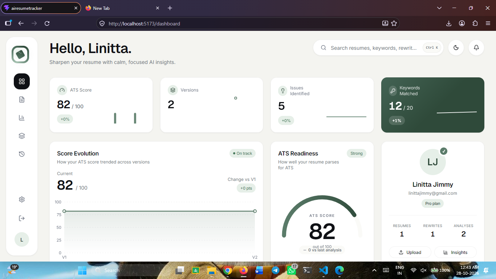

# AI Resume Checker

An AI-powered resume analysis platform built with the MERN stack, Google Gemini AI, Tailwind CSS, and shadcn/ui. Upload your resume as a PDF, evaluate its ATS readiness, identify areas for improvement, generate stronger bullet points, and track your progress through version history and side-by-side comparisons.



## Overview

AI Resume Checker helps job seekers improve their resumes using AI-driven feedback and structured analysis. It evaluates resumes against common Applicant Tracking System (ATS) best practices, highlights strengths and weaknesses, analyzes keywords for a target role, and suggests actionable improvements.

Every upload and applied rewrite is saved as a new version, allowing users to track score changes and compare revisions over time.

## Features

### Authentication and Security
- User registration and login.
- JWT-based authentication using HTTP-only cookies.
- Password hashing with bcrypt.
- Request validation using Zod.
- Per-user rate limiting for AI operations.

### Resume Upload and Parsing
- Upload resumes in PDF format.
- File validation with a 5 MB size limit.
- PDF text extraction using `pdf-parse`.
- Detection of scanned or image-only PDFs that cannot be processed as ordinary text.
- Structured resume parsing with Google Gemini AI.
- Validated JSON output for personal details, experience, education, skills, projects, and certifications.

### AI-Powered ATS Analysis
- Overall ATS-readiness score from 0 to 100.
- Score breakdown across:
  - Keyword relevance
  - Formatting
  - Impact
  - Clarity
- Five prioritized issues with severity levels and recommended fixes.
- Five evidence-based resume strengths.
- Identification of relevant and missing keywords for a target role.

### AI Bullet Point Rewriting
- Rewrite weak resume bullet points with AI.
- Generate stronger, clearer, and more results-oriented descriptions.
- Improve the use of measurable achievements and relevant keywords.
- Provide a rationale for each suggested rewrite.
- Apply selected rewrites or all suggestions in one action.
- Save applied changes as a new resume version.

### Resume Version Control
- Automatic version creation for uploads and applied rewrites.
- Immutable version history.
- Version labels such as V1, V2, and V3.
- Word-level and line-level comparisons.
- Side-by-side comparison of any two resume versions.
- Tracking of resume improvements across revisions.

### Dashboard and Insights
- Dashboard with key performance indicators.
- Latest resume summary and version overview.
- ATS score evolution chart.
- KPI cards with sparklines.
- Recent activity feed.
- Average and best ATS scores.
- Score trends and recurring issues.
- Most frequently present and missing keywords.
- Per-resume performance analysis.
- Filterable version list and chronological account history.

### User Interface
- Responsive design for different screen sizes.
- Light and dark themes.
- Persistent theme preferences.
- Tailwind CSS styling.
- Reusable components built with shadcn/ui.

## Tech Stack

### Frontend
- React
- Tailwind CSS
- shadcn/ui
- Axios
- Charting and data visualization
- Context-based state management

### Backend
- Node.js
- Express.js
- MongoDB
- Mongoose
- JSON Web Tokens (JWT)
- bcrypt
- Multer
- pdf-parse
- Zod

### Artificial Intelligence
- Google Gemini AI
- Structured AI output
- Zod schema validation
- AI-powered resume analysis and rewriting

## Application Workflow

1. Create an account or sign in.
2. Upload a resume in PDF format.
3. Extract and parse the resume text.
4. Convert the resume into structured sections using Gemini AI.
5. Generate an ATS-readiness score and detailed analysis.
6. Review strengths, prioritized issues, and keyword recommendations.
7. Rewrite weak bullet points using AI suggestions.
8. Apply selected improvements to create a new resume version.
9. Compare versions using word-level and line-level diffs.
10. Track performance and improvements through the dashboard and insights pages.

## Getting Started

### Prerequisites

Make sure the following are installed and available:

- Node.js and npm
- MongoDB instance or MongoDB Atlas account
- Google Gemini API key
- Git

### Clone the Repository


### Install Dependencies

Install dependencies separately for the frontend and backend, according to your project structure.

```bash
# Frontend
cd frontend
npm install

# Backend
cd ../backend
npm install
```

### Configure Environment Variables

Create a `.env` file in the backend directory and configure the required variables.

```env
PORT=5000
NODE_ENV=development

MONGODB_URI=your_mongodb_connection_string

JWT_SECRET=your_strong_jwt_secret

GEMINI_API_KEY=your_google_gemini_api_key

CLIENT_URL=http://localhost:5173
```

The variable names above are examples. Match them to the environment variables used by your implementation.

Keep secrets in environment variables and never commit your `.env` file to version control.

### Run the Application

Start the backend:

```bash
cd backend
npm run dev
```

Start the frontend in a separate terminal:

```bash
cd frontend
npm run dev
```

Open the local URL printed by the frontend development server, typically `http://localhost:5173`.

Check the `package.json` files for the actual scripts supported by your project.

## Project Structure

A possible high-level structure for the application is shown below. Adapt it to match your actual repository.

```text
ai-resume-checker/
├── frontend/
│   ├── src/
│   │   ├── components/
│   │   ├── pages/
│   │   ├── context/
│   │   ├── api/
│   │   ├── hooks/
│   │   └── lib/
│   ├── public/
│   └── package.json
│
├── backend/
│   ├── src/
│   │   ├── controllers/
│   │   ├── routes/
│   │   ├── models/
│   │   ├── middleware/
│   │   ├── services/
│   │   ├── validators/
│   │   └── utils/
│   ├── package.json
│   └── .env.example
│
├── .gitignore
└── README.md
```

## Security and Validation

The application incorporates several safeguards:

- HTTP-only cookies for JWT authentication.
- bcrypt password hashing.
- PDF-only upload validation.
- A 5 MB maximum upload size.
- Detection of PDFs without extractable text.
- Zod validation for request payloads and structured AI output.
- Per-user rate limits for AI operations.

Production deployments should also configure HTTPS, secure cookie settings, appropriate CORS policies, and robust error handling. Uploaded resumes and extracted text should be handled as sensitive personal information.

## Future Improvements

Potential enhancements include:

- Exporting improved resumes as PDF or DOCX.
- Matching resumes against uploaded job descriptions.
- Supporting additional document formats.
- Adding resume templates and formatting suggestions.
- Providing more detailed keyword matching.
- Adding downloadable reports and progress summaries.
- Supporting additional AI providers.
- Introducing automated integration and end-to-end tests.

## Learning Resources

This project demonstrates practical implementation of:

- Full-stack development with the MERN stack.
- Authentication and protected API routes.
- PDF file uploads and text extraction.
- Integration with generative AI APIs.
- Structured AI responses and schema validation.
- Resume scoring and keyword analysis.
- Immutable version history and diff generation.
- Dashboard analytics and responsive UI development.

## Contributing

Contributions, bug reports, and feature suggestions are welcome.

1. Fork the repository.
2. Create a feature branch.
3. Implement your changes.
4. Run the relevant tests.
5. Submit a pull request describing your changes.


## Acknowledgments

- [React](https://react.dev/)
- [Node.js](https://nodejs.org/)
- [Express.js](https://expressjs.com/)
- [MongoDB](https://www.mongodb.com/)
- [Google Gemini](https://ai.google.dev/)
- [Tailwind CSS](https://tailwindcss.com/)
- [shadcn/ui](https://ui.shadcn.com/)

---

**AI Resume Checker** — Analyze your resume, improve your bullet points, and track every revision with AI-powered insights.
